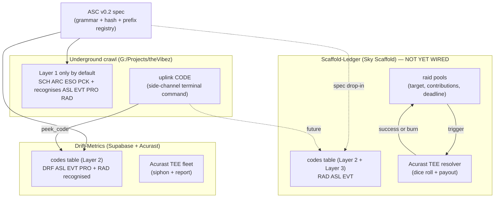
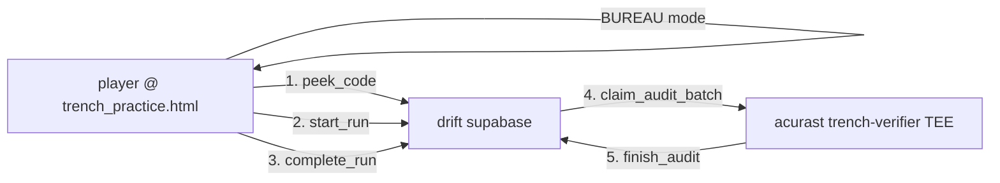

# Asleepius Ecosystem — Cross-Project Reference

The single page that ties Drift-Metrics, Underground crawl, the Fabric
artifacts, and (eventually) Sky Scaffold together via ASC v0.2. Read
this first when returning to the project after time away.

**Spec authority:** [ASC_SPEC.md](ASC_SPEC.md) (v0.2 ecosystem pass)

---

## 1. The shape

Three products. Three backends. One standard. ASC is the only thing
that crosses the border.



Layer 1 is offline-deterministic. Layer 2 is per-product balance.
Layer 3 is per-product coordination (raids). Each product owns its
own backend; the canonical string is the only shared state.

---

## 2. What got built in the ecosystem pass

| Where                                            | What                                                                 | State          |
|--------------------------------------------------|----------------------------------------------------------------------|----------------|
| [`ASC_SPEC.md`](ASC_SPEC.md)                     | v0.2 spec: Layer 3, RAD prefix, cross-mint, URL grammar, Phantom rule | LIVE           |
| [`asc/codes.sql`](asc/codes.sql)                 | Portable Layer 2 SQL (parameterised, drop-in)                        | PRE-STAGED     |
| [`asc/raids.sql`](asc/raids.sql)                 | Portable Layer 3 raid SQL (mint/join/resolve/peek/claim)             | PRE-STAGED     |
| [`asc/acurast/resolver.ts`](asc/acurast/resolver.ts) | Portable TEE raid resolver bundle                                | PRE-STAGED     |
| [`asc/code-surface/`](asc/code-surface)          | `.txt` drop convention + EXAMPLE                                     | LIVE (template) |
| [`../theVibez/underground/crawler/codes.js`](../../theVibez/underground/crawler/codes.js) | Crawl parser bumped to ASC v0.2 (recognises ASL/EVT/PRO/RAD) | LIVE (needs deploy) |
| [`../theVibez/underground.html`](../../theVibez/underground.html) | `uplink` command + `?code=` URL grammar                  | LIVE (needs deploy) |
| [`../theVibez/context/SHRED_CRAWLER.md`](../../theVibez/context/SHRED_CRAWLER.md) §9 | Ecosystem-prefix table for crawler spec               | LIVE           |
| [`../theVibez/fabric/FABRIC_EP2_*.txt`](../../theVibez/fabric) | Three ASL codes planted in EP2.0 post-roll artifacts        | LIVE           |
| [`../theVibez/fabric/FABRIC_EP2_ASC_CODES.md`](../../theVibez/fabric/FABRIC_EP2_ASC_CODES.md) | Operator runbook for the planted codes                    | LIVE           |
| [`../theVibez/index.html`](../../theVibez/index.html) | Drift-Metrics subsidiary link in bottom centre                   | LIVE           |

**LIVE** = changes on disk and in the working code. May still need to
be pushed/deployed to thevibez.com / drift-metrics.com.

**PRE-STAGED** = master copy lives in `asc/`. Not deployed against any
DB. Drop into scaffold-ledger (or any new product) when ready.

---

## 3. The three planted codes (Fabric EP2.0)

| Code                | Planted in                                  | Mint balance | Lore line                                                |
|---------------------|---------------------------------------------|--------------|----------------------------------------------------------|
| `ASL-FREEDOM-V612`  | [`FABRIC_EP2_VERSION_LOG.txt`](../../theVibez/fabric/FABRIC_EP2_VERSION_LOG.txt) footer | 20 scrapes | "every word you reach for has a version. so does this one." |
| `ASL-LOANER-NULL`   | [`FABRIC_EP2_LOANER_TOKENS.txt`](../../theVibez/fabric/FABRIC_EP2_LOANER_TOKENS.txt) entry 31 | 20 scrapes | "not a loaner token. a key." |
| `ASL-RENAME-AUDIT`  | [`FABRIC_EP2_RENAME_LEDGER.txt`](../../theVibez/fabric/FABRIC_EP2_RENAME_LEDGER.txt) audit trail | 20 scrapes | "hearing the rename is the first audit. doing the audit is the second." |

Mint commands and `.txt` artifact templates are in
[`FABRIC_EP2_ASC_CODES.md`](../../theVibez/fabric/FABRIC_EP2_ASC_CODES.md).

---

## 4. Test the loop (end-to-end verification)

This is the recipe that proves the cross-product wiring works.

**Step 1 — Mint** (Drift Supabase SQL Editor, one time):

```sql
select mint_code('ASL-FREEDOM-V612', 20, null, 'fabric ep2.0 / version log');
select mint_code('ASL-LOANER-NULL',  20, null, 'fabric ep2.0 / loaner tokens');
select mint_code('ASL-RENAME-AUDIT', 20, null, 'fabric ep2.0 / rename ledger');
```

**Step 2 — Drift `?code=` URL** (browser):

Open `https://drift-metrics.com/index.html?code=ASL-LOANER-NULL`. The
bridge should show the code with remaining balance (19/20 after first
use). This is the Layer 2 redemption path.

**Step 3 — Underground `uplink` command** (after pushing the
underground changes to thevibez.com and Cloudflare propagates):

- Open `https://thevibez.com/underground.html?code=ASL-LOANER-NULL`. Boot
  should print: `§-relay-37 :: asc code in url → ASL-LOANER-NULL (try uplink)`.
- Type `uplink` (no argument). Should parse the URL-supplied code,
  print prefix/kind/tier/kit-seed, then ping Drift's `peek_code` and
  report Layer 2 balance.
- Type `uplink ASL-FREEDOM-V612` explicitly. Same flow, different code.

If you see "not a code i recognise" in the underground shell for an
`ASL-` code, the browser is loading the OLD `codes.js` (cached or
unpushed). Hard-refresh after `git push`.

**Step 4 — Crawl run-start** (when the run-start UI consumes
`Crawler.Codes.universalEffect()`, downstream of this session):

Entering a universal code at run-start should grant a deterministic
starting kit + a one-line Brox lore based on the hash. This wire-up
isn't done yet — `codes.js` exposes the function; the run-start screen
needs to call it.

---

## 5. Where each piece of the user-facing surface comes from

```
fan finds ASL-* code in Fabric EP2.0 artifact (TXT or video)
              │
              ├─► drift-metrics.com/?code=...   → 20 scrapes (Layer 2)
              │       (handled by Drift bridge.js, already deployed)
              │
              ├─► thevibez.com/underground.html?code=...  → uplink command
              │       (handled by underground.html, after push)
              │
              └─► (eventually) skyscaffold.tld/?code=RAD-...  → join raid pool
                      (handled by asc/raids.sql once scaffold-ledger absorbs it)
```

---

## 6. Deferred work (when scaffold-ledger is ready)

In order:

1. Operator absorbs [`asc/codes.sql`](asc/codes.sql) into scaffold-ledger.
   At that point the cross-mint pattern (ASC §4) is real — same canonical
   `ASL-FOUNDERS-001` minted in both Drift and scaffold-ledger has
   separate balances per product, same hash everywhere.
2. Operator absorbs [`asc/raids.sql`](asc/raids.sql). Raids can be minted
   manually via `mint_raid()` and join/peek RPCs become live.
3. Operator deploys [`asc/acurast/resolver.ts`](asc/acurast/resolver.ts)
   as a separate Acurast TEE bundle (mirrors the Drift `acurast/` build
   pattern). At that point raids actually resolve.
4. Crawl `uplink RAD-...` command starts returning real Layer 3 info
   instead of "uplink dormant" — flip the stub to call
   `peek_raid_by_code` against scaffold-ledger.
5. Sky Scaffold game client gets a "raid panel" — pulls open raids by
   the player's stored code, lets them contribute, polls `claim_raid_loot`
   when raids resolve.

---

## 7. Phantom-discipline reminder (ASC §10)

When wiring Sky Scaffold raids or any new Asleepius surface:

- Tables emit RAW rows (tuples of `code_hash`, `action`, `amount`, `ts`).
- No `intent_score`, `faction_pressure`, `lore_weight`, or any column
  that pre-shapes data for the Phantom engine.
- Phantom (when it exists) derives inferences from raw history. Platforms
  record events.

This rule is non-negotiable. It is the only thing that keeps Phantom's
unknown future schema from forcing migrations on every platform.

---

## 8. Open items (decided but easy to revise)

These were locked to recommended defaults during the ecosystem pass.
Each is a single-file edit if you want to revise:

- **Sub-min contributors on raid success: burn** (don't refund). In
  [`asc/raids.sql`](asc/raids.sql) §7 `resolve_raid` — only contributors
  with sum(amount) >= min get loot rows; others get nothing.
- **`p_base` range: 0.05–0.30** at mint time. In `mint_raid` check.
- **Loot delivery: poll model**. Contributors call `claim_raid_loot`
  with their code. No notification surface (no email, no push) — the
  brand commitment is no accounts.

---

## 9. Backend roles (revised May 2026)

After ops-console v2, the backend roles are now explicit:

| Profile           | Kind        | Owns                                                                                    | RLS posture                                                                                |
| ----------------- | ----------- | --------------------------------------------------------------------------------------- | ------------------------------------------------------------------------------------------ |
| `drift`           | `asc`       | ASC `codes` table + `mint_code`/`peek_code`/`redeem_code` RPCs; (future) `raids` tables | RLS on; anon = read-only via `peek_code`; service-role only mints/redeems                  |
| `scaffold-ledger` | `gamestate` | Sky Scaffold game state for Steam Cloud sync (`player_profiles`, `space_hub_bank`, `death_ledger`, `active_strongholds`, `ledger_receipts`) | RLS pending — needs Steam-ticket → Edge Function → JWT → per-`steam_id` policies. See [STEAM_CLOUD_AUTH_NOTES.md](STEAM_CLOUD_AUTH_NOTES.md) |

**ASC lives entirely in `drift` until Phantom is built.** Codes,
raids, eventual cross-product redemption logic — all of it sits in
drift. Sky Scaffold predates ASC; its game logic gets formalized into
ASC alongside the Phantom engine work. Until then:

- Mint codes in drift.
- Distribute via the `?code=` URL grammar (ASC §9) and the 4-line
  `.txt` artifact (ASC §10).
- Sky Scaffold reads codes today by hitting drift's `peek_code` from
  the game's existing in-game code entry point.
- scaffold-ledger does not host any ASC infrastructure. Adding ASC
  tables there is deferred (and may never happen if drift remains the
  one ASC home).

**Crops → harvestor → consumer.** The front-end tools (drift UI,
theVibez, ops console) are the crops — they produce raw rows. The
Phantom Lore Engine is the harvestor — it shapes raw rows into
shipable lore primitives. Sky Scaffold is the consumer — it
eventually ingests Phantom output. This mirrors ASC §10's
Phantom-discipline rule: platforms emit raw, never pre-shape.

The "Raids" tab in the ops console reflects this — when promoted, it
will read from drift's raid tables, not scaffold-ledger's.

---

## 10. Operator console (local-only)

A new local-only file lives next to the mint console:
[`ops.local.html`](ops.local.html). It is gitignored (`*.local.html`)
and never deploys.

It is the mint console grown into a tabbed operator station that gives
one screen for the whole ecosystem:

- **Bridge** — status of both Supabase profiles, days-to-launch
  countdown, recent codes activity, last-modified vault files, manual
  Acurast deploy checklist.
- **Codes** — cross-product join of every code across drift +
  scaffold-ledger; "absent" badge surfaces what's missing in either
  product; one-click cross-mint button.
- **Mint** — single + batch mint with a profile picker (target either
  drift or scaffold-ledger from the same UI).
- **Lore** — read-only Obsidian browser over the Sky Scaffold vault
  at `AIdle/aidle-terraform/ObsidianVault/Scaff-Obsid-Gen-v2`. Tree
  nav, content search, wiki-link resolution.
- **Build** — parses `04-ACTIVE/TODO.md`, `BUGS.md`,
  `LAUNCH-EXECUTION-PLAN.md`, `MASTER-RELEASE-PLAN.md` and groups
  open/done tasks by P0/P1/P2.
- **Runbook** — quick-render of `ASC_SPEC.md`, `RUNBOOK.md`,
  `HANDOFF.md`, this file, `FABRIC_EP2_ASC_CODES.md`, etc., plus
  user-pinned favorites.
- **Hash Lab** — same offline FNV-1a tooling as the mint console.
- **Raids / Players / Phantom** — registered as stubs; promote when
  scaffold-ledger absorbs `asc/raids.sql`, when Sky Scaffold writes
  player events, and when Phantom defines its consumed schema.

**How to launch.** Two modes; the file detects which:

1. **FSA mode (Chrome/Edge, file://)** — open the file directly. Click
   the FS pill in the header and pick `G:\Projects` as the root. The
   browser remembers the handle via IndexedDB.
2. **Server mode (any browser)** — from `G:\Projects` run
   `python -m http.server 8080`, then open
   `http://localhost:8080/AlgoParallax/Drift-Metrics/ops.local.html`.
   Set serve root to `/` in Settings → Filesystem.

Both Supabase profiles (drift, scaffold-ledger) are configured under
Settings → Profiles. Service-role keys are stored in `localStorage`
on the operator's browser only and never deploy.

The standalone `asc-mint.local.html` is left intact as a focused
single-purpose tool.

---

## 11. Telemetry Trench (live)

`trench_practice.html` + `combat_engine.js` + `trench_items.json` together
form the first **deterministic-engine game-loop test** of the ASC pattern.
This is the trench layer.



### Pieces

| File                                         | Role                                                          | Lives in     |
|----------------------------------------------|---------------------------------------------------------------|--------------|
| `combat_engine.js`                           | Pure deterministic sim (browser + Node + TEE)                 | repo root    |
| `combat_engine_runner.js`                    | Node stdin/stdout CLI shim around `simulate()`                | repo root    |
| `trench_items.json`                          | Item catalog v0.1.0                                           | repo root    |
| `trench_practice.html`                       | Standalone frontend (Practice / Sandbox / **Bureau** modes)   | repo root → drift-metrics.com |
| `smoke.js`                                   | One-line determinism smoke (`node smoke.js`)                  | repo root    |
| `trench.sql`                                 | `trench_runs`, `trench_terminated_pool`, 5 RPCs, RLS, grants  | drift schema |
| `acurast/trench-verifier/`                   | Second Acurast project: re-runs samples on TEE                | acurast      |
| `TRENCH_DEPLOY.md`                           | End-to-end deploy + smoke checklist                           | repo root    |

### Role in the four-role model

- **Crop** — every Bureau-mode submission is a raw `trench_runs` row.
  No "skill score", no "intent", no shaping. Just `{seed, board, drift, winner, final_state}`.
- **Harvestor** — Phantom (future) will read these rows to drift faction
  opinion / lore. Until then nothing reads them but the verifier.
- **Consumer** — the player who finds a `TRN-…` code. The reward is a
  Bureau run.
- **Operator** — you, minting TRN codes via `ops.local.html` Mint tab.

### The audit story

The engine is deterministic. Same `{player_board, ghost_board, drift_score,
seed, round_number}` ⇒ same `{winner, final_state, tick_log}`, byte-for-byte.

We exploit this by **storing inputs + outputs**, then asynchronously
re-running on TEE hardware. The verifier reads
`audit_status='pending'`, replays, and stamps `verified` (byte-match) or
`mismatch` (tampering / version drift).

This is materially equivalent to running the engine on the TEE in the player
critical path — without the latency cost. Mismatches surface after the fact
rather than blocking submission. The brand stays human-paced.

### TRN prefix

Layer 2 only. Defaults: `balance=1`, `expires_at = now() + 30 days`. Burned
on completion only — abandoning a tab doesn't waste the code. Hash tier and
hidden flag are honoured for cosmetic flavour in the UI; the gate itself is
purely balance.

See `ASC_SPEC.md §3` for the prefix entry and `trench.sql` for the schema.

### What ships at the start of the launch window

- `trench.sql` deployed in drift.
- `trench_practice.html` deployed at `drift-metrics.com`.
- A small batch of hand-minted `TRN-2026-MAY-*` codes ready for community
  distribution as artifact drops.
- Acurast verifier running on a 15-minute interval.

### What's deferred

- Bureau-mode round selector (currently inherits from the
  Progress/Sandbox state at mode-switch time).
- Ops console **Trench tab** (data model done; UI not yet wired).
- TRN-prefix cross-mint with Sky Scaffold (waits on Steam-ticket auth — see
  `STEAM_CLOUD_AUTH_NOTES.md`).
- Code-surface artifact template for TRN drops.

---

## 12. Don't forget

- Each product owns its own backend. Don't unify them.
- A code is the account. Don't add accounts.
- Acurast is the legitimate exception to "no third-party SaaS" — it's
  attested distributed compute, not a managed service. Use it for any
  resolution that needs verifiable randomness or atomic state.
- The `.txt` code-surface artifact (ASC §9) is the brand's distribution
  channel. No URL shorteners. No analytics. Plain text moves bytes.
